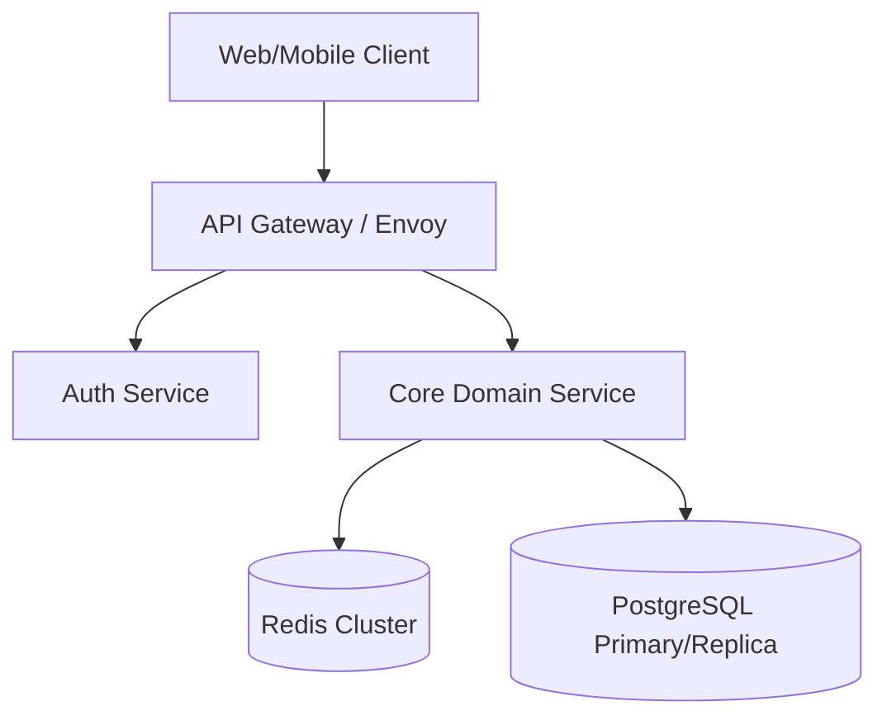

```mermaid
graph TD
  Client[Web/Mobile Client] --> Gateway[API Gateway / Envoy]
  Gateway --> Auth[Auth Service]
  Gateway --> Core[Core Domain Service]
  Core --> Cache[(Redis Cluster)]
  Core --> DB[(PostgreSQL Primary/Replica)]
```

<!-- Logged: 2026-05-12 09:15:00 -->
# Microservices Architecture (C4 Model)

<!-- Logged: 2026-05-27 09:15:00 -->
# Microservices Architecture (C4 Model)

<!-- Logged: 2026-07-02 13:45:00 -->
# Microservices Architecture (C4 Model)

<!-- Logged: 2026-07-19 09:15:00 -->
# Microservices Architecture (C4 Model)

<!-- Logged: 2026-08-11 09:15:00 -->
# Microservices Architecture (C4 Model)

